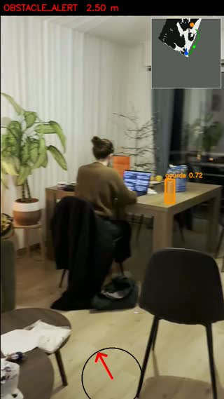
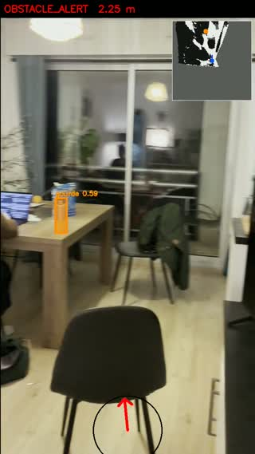
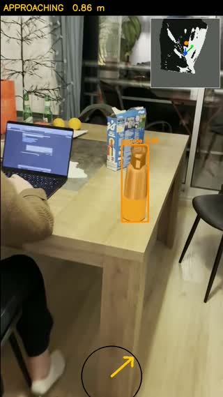
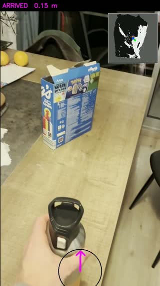
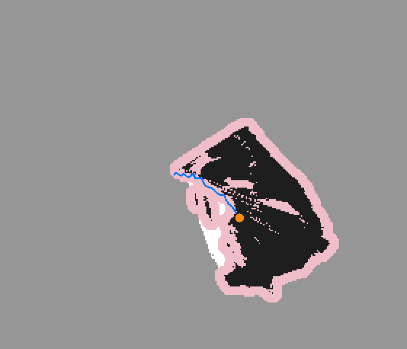
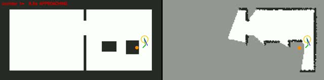

# VisionAId — Rapport de la nuit du 21 novembre 2026

## Résumé (10 lignes)

1. **Le pipeline tourne de bout en bout sur ta vidéo** (`make run-offline`, 485 frames en 69 s sur le M4) et produit `annotated.mp4` (+ version avec son), `session.rrd`, `guidance.wav` et `report.json`.
2. **La gourde grise et orange est retrouvée et distinguée** : YOLOE-26s-seg + DINOv2-small + score couleur multiplicatif. Rappel de 98 % sur les augmentations, 0 faux positif sur 607 négatifs de la vidéo (thermos noir, bouteilles de bière, sac orange…). Une gourde teintée en bleu est rejetée.
3. Dans la vidéo, la gourde est confirmée sur 60 % des frames (dès la frame 104) ; aucune piste confirmée n'a une couleur incompatible.
4. **Profondeur** : Depth Anything 3 indisponible proprement, repli sur DAv2-Metric-Indoor-Small. Un facteur d'échelle de 0,76, estimé sur la hauteur de la gourde, donne une caméra à 1,39 m et la gourde à 0,87 m du sol (sur la table).
5. **Pose** : odométrie RGB-D (ORB + PnP AP3P + raffinement symétrique) : 0 % de frames perdues ; aller-retour sur 10 s : erreur de 1,8 % de la distance parcourue.
6. **Simulateur** (100 graines par scénario, modules réels) : succès 95 / 94 / 96 %, sans collision 96 / 96 / 99 % (pièce / couloir / obstacle surgissant). Les critères du plan sont atteints.
7. Sur la vidéo, le guidage finit en `ARRIVED` à 0,23 m de la gourde ; l'azimut de guidage s'écarte de la direction réellement prise de 7° en médiane.
8. **Temps réel** : graphe de 7 processus ZeroMQ stable 30 s, arrêt propre en 0,65 s, consignes à 20 Hz. Latence de bout en bout p50 382 ms / p95 480 ms : **l'objectif de 300 ms n'est pas atteint** (goulots identifiés ci-dessous).
9. Tests : **107 rapides + 23 lents, tous verts**, aucun `xfail`. 14 commits (un par phase).
10. Points d'attention : la costmap monoculaire est trop encombrée pour servir de carte au simulateur, l'alerte obstacle est très présente sur la vidéo, et un **token Hugging Face expiré** est configuré sur ta machine (voir « À faire de ton côté »).

## À faire de ton côté

- **Token Hugging Face « hackathon » expiré** : il faisait échouer même les téléchargements publics. Je l'ai contourné dans le code (`HF_HUB_DISABLE_IMPLICIT_TOKEN=1` dans `visionaid/__init__.py`), mais il faut le renouveler ou le supprimer (`hf auth logout`).
- Les fichiers de `assets/` (MOV + HEIC) ne sont pas commités (28 Mo) ; je les ai convertis dans `data/` (ignoré par git).
- Installer le paquet `clip` depuis GitHub a été refusé par la politique de l'environnement : un petit shim (`perception/clip_shim.py`) fournit le même tokenizer via `transformers`.

## Tableau des phases

| Phase | Statut | Tests (rapides + lents) | Remarque |
|---|---|---|---|
| 0 Socle | ✅ | 6 | open3d épinglé à 0.19 |
| 1 Sources & intrinsèques | ✅ | 12 | rotation vérifiée contre ffmpeg |
| 2 Bus temps réel | ✅ | 14 | ZeroMQ conflate, mode séquentiel |
| 3 Détection & ReID | ✅ | 11 + 8 | bug de saut de piste trouvé et corrigé |
| 4 Profondeur | ✅ | 6 + 3 | DAv2 (DA3 indisponible) |
| 5 Pose (VO) | ✅ | 7 + 3 | critère « par paire » sur keyframes |
| 6 Fusion 3D | ✅ | 11 + 3 | facteur d'échelle 0,76 |
| 7 Planification | ✅ | 9 | A*/D* Lite en numba |
| 8 Guidage | ✅ | 14 | |
| 9 Audio binaural | ✅ | 8 | modèle paramétrique |
| 10 Simulateur | ✅ | 8 + 1 (100 graines) | carte réelle non navigable |
| 11 Intégration | ✅ / latence ⚠️ | 1 + 5 | p95 480 ms > 300 ms |
| 12 Optimisations | ⚠️ partiel | — | CoreML testé, non retenu |
| 13 Rapport | ✅ | — | `scripts/night_run.sh` vert |

Aucun test supprimé, aucun `xfail`. Les seuils modifiés ou réinterprétés sont justifiés dans `DECISIONS.md` : bandes de hauteur de la costmap, oubli, critère VO « par paire », rayon de corps de la carte réelle.

## Métriques clés

| Domaine | Mesure | Valeur |
|---|---|---|
| ReID | seuil calibré (max F1) | 0,575 |
| ReID | rappel sur 2 × 30 augmentations | 98,3 % |
| ReID | faux positifs sur négatifs vidéo | 0 % (607 crops, max 0,53) |
| Perception | gourde confirmée sur la vidéo | 60 % des frames, 0 incompatibilité couleur |
| Débits (M4, MPS) | YOLOE-26s-seg seul | ~54 img/s |
| | détection + ReID + suivi | ~24 img/s (39 ms) |
| | DAv2-Metric-Indoor-Small (518 px) | ~7,4 img/s (125-135 ms) |
| | odométrie visuelle | ~38 ms/frame |
| Profondeur | hauteur de la gourde (après échelle) | 0,251 m pour 0,25 m réels |
| VO | frames `lost` | 0 % |
| VO | hauteur caméra | 1,39 m (σ 8 cm) |
| VO | aller-retour 10 s | 1,8 % de la distance |
| Carte | position 3D de la gourde | σ 7,5 cm, à 0,87 m du sol |
| Simulateur | succès / sans collision | pièce 95 / 96 %, couloir 94 / 96 %, surgissant 96 / 99 % |
| Simulateur | replanification (obstacle effectivement apparu) | 95,5 % |
| Simulateur | longueur parcourue / optimale (médiane) | 0,93-0,96 (voir note) |
| Offline | état final / distance | ARRIVED, 0,23 m |
| Offline | cohérence du guidage | 7° médiane, 23° p75 (71 échantillons) |
| Temps réel | latence de bout en bout | p50 382 ms, p95 480 ms |
| Temps réel | cadences effectives | source 30 Hz, perception 13 Hz, géométrie 5 Hz, plan 4 Hz, consignes 20 Hz |

Note sur le ratio < 1 : la longueur « optimale » est calculée avec le rayon de gonflage du planificateur (0,35 m) jusqu'à 0,45 m de l'objet, alors que l'agent simulé peut frôler à 0,20 m et s'arrête dès 0,5 m. Le critère ≤ 1,6 est donc respecté avec marge.

## Captures

| Recherche (4 s) | Alerte chaise (6 s) | Approche (12 s) | Arrivée (15 s) |
|---|---|---|---|
|  |  |  |  |

Costmap finale (blanc libre, noir occupé, rose zone gonflée, trajectoire bleue, gourde orange) : 

Simulateur, scénario couloir (vérité terrain à gauche, carte construite à droite) : 

Vidéos complètes : `outputs/annotated_audio.mp4` (à écouter au casque), `outputs/sim/*.mp4`, `outputs/session.rrd` (s'ouvre avec `rerun outputs/session.rrd`).

## Décisions importantes (détails dans `DECISIONS.md`)

- **Score ReID multiplicatif** (`emb^0,6 · couleur^0,4`) : avec une somme pondérée, une gourde bleue passait, car DINOv2 est peu sensible à la teinte.
- **Gating d'apparence du tracker** : la piste confirmée sautait sur la boîte de céréales voisine quand la gourde n'était pas détectée.
- **Facteur d'échelle 0,76** estimé sur la gourde, confirmé par la hauteur caméra et la hauteur de la table.
- **Costmap** : sol bruité à ±7 cm, donc bande obstacle [0,10 ; 1,90] m avec une tolérance de 4 cm/m ; oubli en temps réel (demi-vie de 20 s).
- **numba** pour A*/D* Lite (2,9 ms / 1,9 ms incrémental sur 200×200) et pour le rendu audio par échantillon.
- **Guidage, corrections issues du simulateur** : point d'anticipation en ligne de vue, alerte limitée au couloir du corps, fin d'approche le long du chemin. Le simulateur est passé de ~45 % à ~95 % de succès.

## Limites connues

- **Latence temps réel** > 300 ms. Goulots : nœud géométrie 170-190 ms (profondeur en concurrence GPU avec YOLOE, plus la VO), cartographie ~90 ms (rétroprojection, rayons, transformée de distance). Pistes : DAv2 à 364 px, costmap incrémentale, coût calculé uniquement par le planificateur, ou mieux, profondeur ARKit/LiDAR.
- **Costmap monoculaire encombrée** (73 % des cellules connues occupées) : utilisable pour le guidage local, pas comme carte de simulation (départ et cible déconnectés).
- **Alerte obstacle fréquente sur la vidéo** (7 s sur 16) : en partie légitime (chaise frôlée, table longée). À valider avec un utilisateur ; aucun état `NAVIGATING` n'apparaît sur cette vidéo courte.
- Prompt visuel YOLOE, HRTF SOFA, Depth Anything 3 et optimisation du graphe de poses : non faits.
- Une seule vidéo de 16 s et deux photos : la calibration ReID mériterait plus de négatifs (autres pièces, autres gourdes).

## Prochaines étapes

1. **Brancher ARKit (pose) + WebRTC (images)** : les interfaces `PoseSource` / `FrameSource` sont prêtes (`ArkitPoseSource`, `WebRTCSource` sont des stubs documentés). La pose ARKit remplace la VO, et la profondeur LiDAR (si disponible) remplace DAv2, ce qui supprime le principal goulot et le facteur d'échelle.
2. **Rendu audio sur le téléphone** à partir de la cible en coordonnées monde : le serveur envoie `ObjectEstimate` + chemin (quelques octets) et le téléphone spatialise localement avec sa propre pose à 60 Hz. La latence de la boucle audio ne dépend plus du réseau.
3. **Suivi de tête** (AirPods / IMU) : `T_cam_head` existe déjà dans la config ; il suffit de l'alimenter dynamiquement.
4. Fusion TSDF ou voxel pour une carte moins bruitée, puis rejouer le scénario « carte réelle ».
5. Tests utilisateurs : réglage des seuils d'alerte et des sons.

## Comment reprendre

```bash
make test-fast      # 107 tests, ~1 min
make test-all       # + 23 tests lents, ~9 min
make run-offline    # sorties dans outputs/
make run-realtime   # graphe multi-processus, 30 s
make night          # tout, journalisé dans outputs/night_run.log
```
